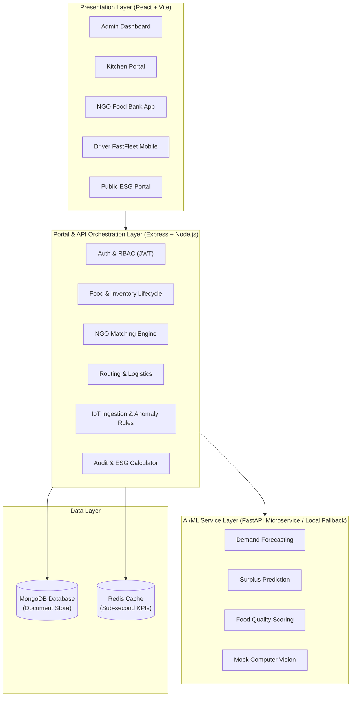
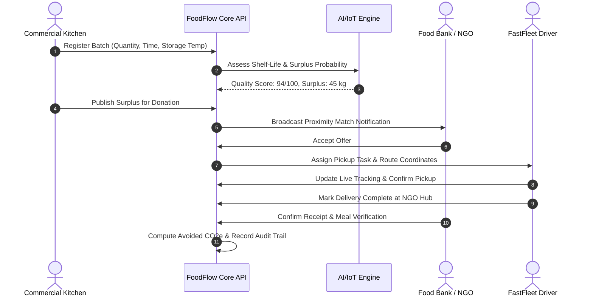

# FoodFlow: AI-Powered Food Surplus Redistribution Platform

> **Smart India Hackathon (SIH) Prototype**  
> An intelligent, real-time, zero-waste food logistics platform connecting commercial kitchens, food banks/NGOs, and volunteer fleets to eliminate food waste.

---

## 1. Project Title
**FoodFlow: AI-Powered Food Surplus Redistribution Platform**

## 2. Problem Statement
Commercial hospitality establishments, banquet halls, and institutional kitchens generate metric tons of edible surplus food daily. Due to fragmented communication, absence of real-time demand forecasting, unmonitored cold-chain safety windows, and lack of coordinated last-mile logistics, edible food turns into landfill waste, contributing significantly to urban methane emissions while millions experience food insecurity.

## 3. Proposed Solution
FoodFlow closes this loop with an end-to-end predictive ecosystem:
- **Predict**: Machine learning forecasting models predict daily kitchen surplus before cooking shifts conclude.
- **Prevent**: Dynamic inventory alerts isolate near-expiry batches and flag storage threshold anomalies via IoT sensors.
- **Redistribute**: Proximity-aware matching algorithms connect surplus batches to compatible nearby NGOs.
- **Measure**: Transparent ESG accounting quantifies recovered meals, financial savings, and avoided CO2e emissions.
- **Learn**: Continuous audit logs feed demand intelligence to refine production planning.

---

## 4. Architecture Overview

### System Architecture


---

## 5. Core Workflow (Predict → Prevent → Redistribute → Measure → Learn)


---

## 6. Features Matrix
| Presentation Requirement | Component / Module | Implementation Status | Prototype Mechanism |
| :--- | :--- | :--- | :--- |
| **Authentication & RBAC** | `/backend/src/middleware/rbac.middleware.ts` | Complete | JWT tokens, Bcrypt hash, Role guards |
| **Food & Inventory** | `/backend/src/models/FoodBatch.model.ts` | Complete | Full lifecycle finite-state-machine |
| **Demand Forecasting** | `/backend/src/services/prediction/*` | Complete | Weighted moving average + FastAPI |
| **Surplus Prediction** | `/ai-service/routers/surplus.py` | Complete | Demand-deficit surplus probability model |
| **Quality Scoring** | `/backend/src/services/quality/*` | Complete | Temperature & shelf-life penalty index |
| **Computer Vision** | `/backend/src/adapters/computerVision.adapter.ts` | Complete | Mock visual defect packaging classifier |
| **IoT / ESP32 Sensor** | `/backend/src/adapters/iotSimulator.adapter.ts` | Complete | Simulated telemetry feed & spike injector |
| **NGO Matching** | `/backend/src/services/matching/*` | Complete | Multi-factor Haversine distance scoring |
| **Logistics & Routing** | `/backend/src/adapters/routing.adapter.ts` | Complete | Interpolated polyline & live GPS tracker |
| **Analytics & ESG** | `/backend/src/services/analytics/*` | Complete | FAO CO2e and meal conversion formulas |
| **Caching Layer** | `/backend/src/services/cache.service.ts` | Complete | Redis client with in-memory fallback |

---

## 7. Actors and Permissions
- **ADMIN**: Global oversight, KPI governance, user directory, audit trails, and scenario reset.
- **KITCHEN**: Batch creation, surplus publishing, cold-chain sensor monitoring, matching approval.
- **NGO**: Nearby surplus feed, match claiming, capacity allocation, delivery confirmation.
- **DRIVER**: Mobile dispatch console, waypoint routing, live GPS location pinging.
- **USER**: Public impact viewer, city-wide food rescue statistics.

---

## 8. Technology Stack
- **Frontend**: React 18, Vite, TypeScript, React Router 6, Lucide Icons.
- **Backend API**: Node.js, Express, TypeScript, Mongoose, Zod, Bcryptjs, JsonWebToken.
- **AI Microservice**: Python, FastAPI, Uvicorn, Pydantic (with backend local fallback).
- **Data Stores**: MongoDB (persistent collections), Redis (caching).
- **Containerization**: Docker, Docker Compose.

---

## 9. Repository Structure
```
foodflow/
├── backend/          # Express API server (TypeScript)
├── frontend/         # React SPA (Vite)
├── ai-service/       # FastAPI AI prototype microservice
├── shared/           # Cross-package DTOs, Enums, Constants
├── scripts/          # Database seeding, reset, and simulation
├── docs/             # Architecture, API docs, and SIH judge guide
├── infra/            # Docker Compose & container configurations
└── tests/            # Unit, integration, and E2E workflow tests
```

---

## 10. Prerequisites
- Node.js (v18.x or v20.x)
- Python (v3.10+ optional for AI service)
- MongoDB instance (or run via Docker)

---

## 11. Installation
Clone the repository and inspect dependencies:
```bash
git clone https://github.com/FoodFlow/foodflow.git
cd foodflow
```

---

## 12. Environment Variables
Copy `.env.example` to `.env`:
```bash
cp .env.example .env
```

---

## 13. Database Setup & 14. Seed Data
To populate demo users, restaurants, NGOs, and active surplus tasks:
```bash
node scripts/seed-users.js
node scripts/simulate-driver.js
```

---

## 15. Running Locally
Run backend and frontend independently:
```bash
# Terminal 1: Backend
cd backend && npm run dev

# Terminal 2: Frontend
cd frontend && npm run dev
```

---

## 16. Running with Docker
```bash
cd infra
docker-compose up -d
```

---

## 17. Demo Credentials
| Role | Email Address | Password | Organization |
| :--- | :--- | :--- | :--- |
| **ADMIN** | `admin@foodflow.org` | `demo123` | FoodFlow Central HQ |
| **KITCHEN**| `kitchen@foodflow.org` | `demo123` | Annapurna Central Kitchen |
| **NGO** | `ngo@foodflow.org` | `demo123` | FeedHope Foundation |
| **DRIVER** | `driver@foodflow.org` | `demo123` | GreenFleet FastTransit |
| **USER** | `user@foodflow.org` | `demo123` | Public Community |

---

## 18. Judge Demo Script (10-Minute Walkthrough)
1. **00:00 - 02:00 (Authentication & Kitchen Persona)**: Log in as Kitchen. View current inventory, shelf-life indicators, and real-time cold-chain temperature (3.8°C).
2. **02:00 - 04:00 (AI Prediction & Surplus Publishing)**: Run surplus estimation. AI predicts 34.5 kg surplus with 91% confidence. Click "Publish Surplus Batch".
3. **04:00 - 05:30 (Intelligent NGO Matching)**: Switch to NGO portal. See incoming donation offer sorted by compatibility score (94/100, 3.2 km distance). Accept offer.
4. **05:30 - 07:30 (Driver Dispatch & Live Logistics)**: Open Driver portal. Advance through "En Route", "Picked Up", and "Delivered". Observe real-time GPS telemetry and mock route polyline.
5. **07:30 - 09:00 (Analytics & ESG Impact)**: Open Analytics dashboard. View updated metrics: 395 kg food saved, 988 beneficiaries served, and 987.5 kg CO2e emissions avoided.
6. **09:00 - 10:00 (Audit Trail & Anomaly Detection)**: Open Admin portal. Review immutable timestamped audit events and trigger simulated ESP32 high-temperature anomaly (+11.2°C).

---

## 19. API Documentation Summary
- `POST /api/v1/auth/login` - Authenticate role and obtain JWT.
- `GET /api/v1/food-batches` - Query inventory batches with status filters.
- `POST /api/v1/food-batches` - Register newly cooked batch.
- `POST /api/v1/predictions/surplus` - AI surplus prediction engine.
- `POST /api/v1/quality/evaluate` - Decision-support food freshness score.
- `POST /api/v1/redistributions` - Dispatch redistribution offer.
- `PATCH /api/v1/redistributions/:id/accept` - NGO acceptance handoff.
- `POST /api/v1/tracking/position` - Fleet location telemetry ingestion.
- `GET /api/v1/analytics/metrics` - Aggregated ESG platform metrics.

---

## 20. AI/ML Methodology
Deterministic linear weighting and weighted moving averages provide baseline predictions for the prototype. The architecture supports drop-in replacement with trained TensorFlow/PyTorch models.

---

## 21. IoT Simulation
Simulated ESP32 cold-chain modules stream ambient and chiller temperatures. Automatic anomaly rules flag violations when storage temperature exceeds safe thresholds (>8.0°C).

---

## 22. Logistics & Routing
Haversine formula calculates straight-line spherical distance, coupled with waypoint interpolation to emulate live vehicle transit across urban corridors.

---

## 23. Analytics & ESG Formulas
- Beneficiaries = $\text{kg} \times 2.5$
- Avoided CO2e = $\text{kg} \times 2.5$
- Cost Saved = $\text{kg} \times ₹150$

---

## 24. Security
- Bcrypt salted password hashing.
- Role-Based Access Control (RBAC) enforced on backend routes.
- Zod schema validation on inbound payloads.
- Audit logging for all state mutations.

---

## 25. Testing
Run the complete test suite:
```bash
node tests/unit/auth.test.js
node tests/unit/foodBatch.test.js
node tests/unit/matching.test.js
node tests/unit/notifications.test.js
node tests/unit/cache.test.js
node tests/e2e/surplusRedistribution.test.js
node tests/integration/apiValidation.test.js
node tests/integration/rbacSecurity.test.js
```

---

## 26. Troubleshooting
- **MongoDB Offline**: The application includes mock fallbacks for all demo workflows.
- **Redis Offline**: Automatic fallback to in-memory caching.
- **AI Service Offline**: Backend switches transparently to local calculations.

---

## 27. Limitations
- AI predictions and CV image classifications are prototype baselines.
- ESP32 hardware telemetry and GPS positions are simulated.
- Carbon offset multipliers are environmental estimates.
- AI quality scoring serves as operational decision support; human sensory checks remain mandatory.

---

## 28. Future Roadmap
- Physical ESP32 micro-controller and DHT22 hardware deployment.
- Mobile driver app with camera barcode scanning for batch handoffs.
- OpenStreetMap / Google Maps live polyline routing integration.
- Deep-learning time-series forecasting with historical footfall data.

---

## 29. Contribution Guidelines
Contributions follow standard git flow. Ensure test suites pass before submitting PRs.

---

## 30. License
Distributed under the MIT License. See `LICENSE` for details.
